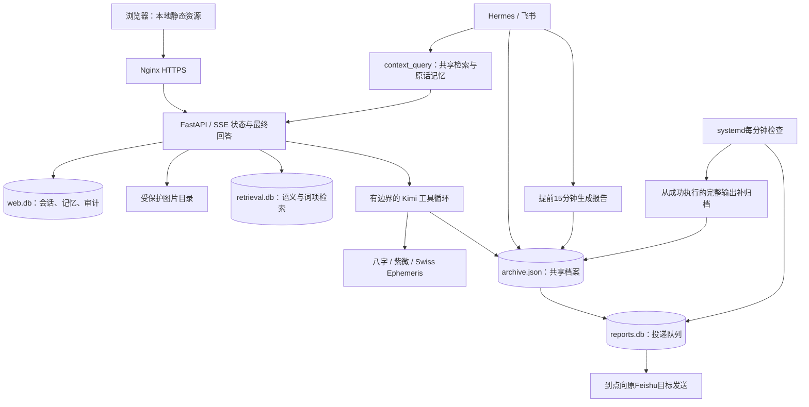

# 明镜台 v4 交接记录

上线日期：2026-09-28。网站：https://p.jerrymeng.asia 。视觉方向：浅色纸感，偏阅读与报告。

## 本次完成

- 全站改为暖白纸面、灰绿导航、克制的金色强调；重排对话工作区、报告阅读和移动端导航。七个页面均支持直接网址、前进后退、键盘操作。
- 前端脚本、样式、Markdown解析和清理库改为本地资源，不再依赖运行时CDN。Markdown清理脚本、事件属性和外部图片；修复旧动态点击参数转义问题。
- 对话支持多会话、分页历史、输入草稿、停止、重试、断线查询结果。服务端先保存问题与图片，再执行模型；重启中断会标明状态，不假装完成。
- 本次之后上传的图片压缩、校正方向后保存在受鉴权保护的目录，网页可回看，模型可按需重读同一会话附件。旧版本没有保存的图片无法追溯恢复。
- 本地中文语义检索与词项匹配共同召回。初建索引1,858个片段，补归档后约2,000个片段，涉及364条双端历史消息及原有档案；不把全部历史直接塞进提示词。
- 长期记忆必须引用用户原话；飞书入口需核对真实用户消息ID。网页支持编辑、停用、恢复及查看修改记录。旧预测不是事实，假设场景不能自动作为事实写入。
- 网页模型可检索、读完整资料、计算其他日期、重读图片、保存有出处的记忆。最多8轮、7个不同日期，最终通过结构化工具提交答案。服务器校验引用存在、排盘依据及字段格式。
- 紫微保留本宫、三合、对宫和四化落点联动；星盘保留本命相位、容许度和行运关联。补修八字跨年流月显示，以及快速切换日期造成旧请求覆盖新结果的问题。
- 报告增加类型/全文筛选、导出、打印及投递状态。档案导出改为真实文件下载。
- 晨报06:45准备、07:00投递；周报19:45准备/周日20:00投递，月报08:45准备/每月1日09:00投递，季报09:45准备/季度首日10:00投递。时区均为Asia/Shanghai。
- Hermes原有四个cron任务保留，改为提前准备且deliver=local；独立队列负责原目标投递。另有完整cron输出归档补偿、生成重试、投递重试与幂等保护，不另发测试消息。
- 归档补偿实际恢复21篇遗漏的历史报告，报告总数18→39；均从成功执行的最终正文恢复，保留原文，未把历史预测重新认证为事实。
- Hermes运行版本核验为v0.21.5，提交f97608f178；本次同步更新知命Skill为v4。

## 当前架构

### 聊天策略

1. 固定保留必要出生资料、连续话题、用户更正和校准信息；近期对话最多32条且约12,000字符。
2. 对当前问题召回相关旧记录，同时提供来源和record_id；需要时继续读取全文。检索排序是候选排序，不是事实判断。
3. 命盘问题先计算实际数据，按需补算其他日期；不从单日快照虚构逐日差异。普通聊天不强制套入命盘。
4. 模型通过final_answer提交正文、依据、缺口和行动。服务器校验结构与引用是否存在，前端可展开来源。
5. 回答完成后持久化；后台定期把完整会话与当天问题镜像到共享文件，失败时补偿。来源引用校验不等于语义正确性证明，也不代表命理预测具有科学效力。

### 关键位置

| 内容 | 服务器路径 |
|---|---|
| Web后端与静态页 | `/root/mingjingtai/` |
| 解读提示词 | `/root/mingjingtai/zhiming-web.md` |
| 排盘、上下文、记忆、报告模块 | `/root/.hermes/skills/zhiming/` |
| 共享档案 | `/root/.hermes/zhiming/archive.json` |
| 新增数据库 | `/root/.hermes/zhiming/web.db`、`retrieval.db`、`reports.db` |
| 图片 | `/root/.hermes/zhiming/images/` |
| 语义模型与校验清单 | `/root/.hermes/zhiming/models/minilm/` |
| 投递配置 | `/root/.hermes/zhiming/report-pipeline.json` |
| 队列健康记录 | `/root/.hermes/zhiming/report-worker-health.json` |
| Hermes计划与执行记录 | `/root/.hermes/cron/jobs.json`、`executions.db` |
| 新服务 | `mingjingtai-reports.service`、`mingjingtai-reports.timer` |

语义模型为固定revision的[Xenova multilingual MiniLM ONNX](https://huggingface.co/Xenova/paraphrase-multilingual-MiniLM-L12-v2/tree/2c4055b12046f11709e9df2c122e59ffbdc2f900)，量化模型在CPU本地运行，单线程、小批次，模型文件约118MB。首次全量建索引约145秒，已在上线前完成；后续仅重算变化片段。上线后Web服务内存约455MiB。

投递使用固定请求UUID。[飞书官方SDK说明](https://larksuite.github.io/oapi-sdk-java/com/lark/oapi/service/im/v1/model/CreateMessageReqBody.Builder.html)给出的去重窗口为1小时；本实现遇到网络结果不明，仅在50分钟内重试，之后停为“送达待核对”。后续重试收到拒绝，也不会把此前不明状态误当成未发送。只有明确失败的记录开放网页重试。

## 验证记录

- 16项Python测试通过：三盘计算、UTC、日期联动、并发归档、报告幂等、迁移、记忆原文约束/审计、图片处理、鉴权、取消、请求重放、同时间戳分页、投递时刻、去重边界与补偿。
- 两组前端测试通过：三盘联动和结构化选择；七路由、实际排盘数据渲染、报告筛选/折叠、Markdown清理、动态参数转义、记忆编辑、SSE跨数据块解析及按钮状态。
- 独立暂存环境实际调用模型成功：补算另一日期、最终引用7条依据；偏好记忆保存/停用/审计成功。暂存测试不写生产用户会话，不发送飞书消息。
- 实际中文换说法召回命中了住房事实，排除了无关自行车记录；测试检查候选召回，不夸大为任何查询都排第一。
- 公网首页、6个静态资源、历史/会话/记忆/三盘/检索接口通过；无效口令访问被拒绝。健康接口版本4.0、索引hybrid，片段随后续归档与对话增量更新。
- Web和Hermes服务active；报告timer已启用，worker健康记录与systemd Result=success确认执行。
- 下一次晨报准备：2026-09-29 06:45；计划投递：2026-09-29 07:00。尚未到首次新流程投递时刻，因此没有宣称实际按时收到。网络和生成耗时仍可能造成延迟，状态可在报告页查看。
- 视觉验收限制：Windows Computer Use因无法可靠判定当前浏览器网址而停止，未继续操作浏览器。已完成DOM与样式结构检查，但真实桌面/手机截图观感尚未验收。

## 部署与恢复

本地执行 `npm ci`、`npm run build`；修改`main.py`、`static/`或`hermes/`中的源文件。`deploy.py`上传本地静态资源和Python模块，再重启Web；不包含口令。一次性转换脚本仅用于本次迁移，不应重复应用到新版源码。

更新前备份：`/root/zhiming-backups/20260928/before-v4.tgz`，原cron独立备份：`/root/zhiming-backups/20260928/cron-before-pipeline.json`。本地原版本在`private/v3-source/`。发生回退时先停用报告timer，避免恢复旧cron直发后重复投递；保留新数据库和图片，恢复应用代码与原cron配置，再重启服务。不要直接覆盖上线后的用户档案/历史；回退前先再做一份当前数据快照。

没有更改访问口令或对外开放数据库。日志与本文不记录凭据。
