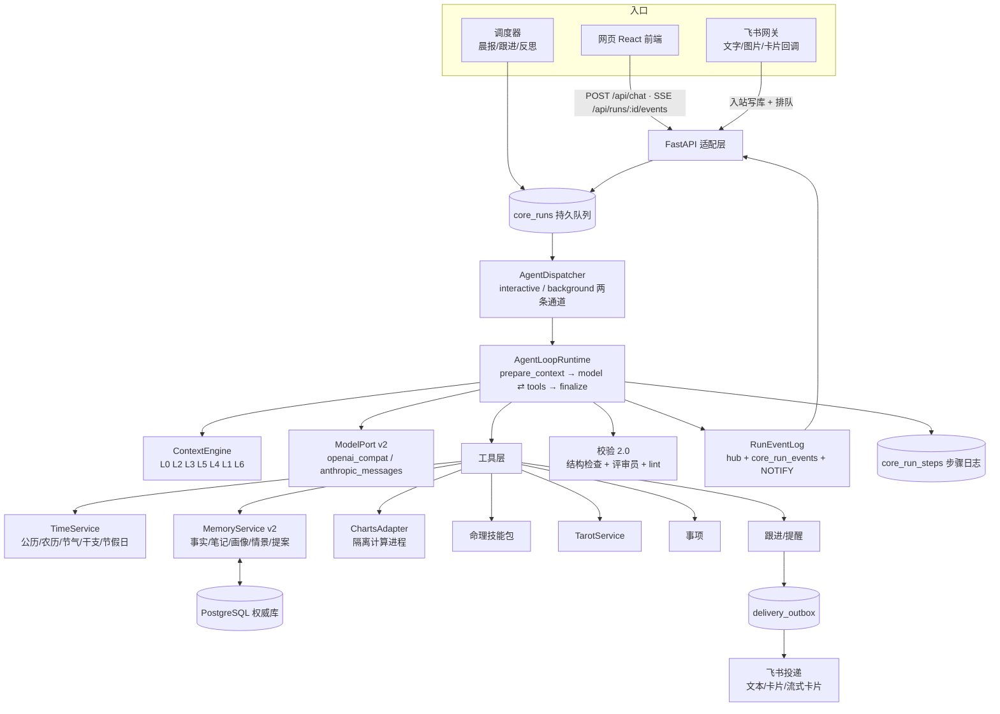

# 02 · 知命明镜台 Core v4 架构蓝图

> 作者：Claude（大脑）　读者：Codex（开发者）与项目所有者
> 日期：2026-10-17（Asia/Shanghai）
> 本文是 v4 的**设计真相源**。各阶段提示词（`05_Codex提示词/P*.md`）引用本文的章节号。
> 若实现中发现本文与真实代码冲突：以真实代码为事实、以本文为意图，把冲突写进当前 ExecPlan 的 *Surprises & Discoveries*，并在阶段回执里报告，**不要自行改变意图**。

---

## 0. 产品定位与设计原则

**产品一句话：** 一位懂命理的老朋友——记得你的事、知道今天是什么日子、会主动关心和追问，用八字/紫微/星盘/塔罗帮你看清局面，再陪你把现实里的决定想清楚。

**十条设计原则（所有阶段都必须遵守）**

1. **模型做判断，程序做事实。** 盘面、日期、节假日、记忆写入、抽牌、投递都由确定性代码完成并产生回执；模型只能通过工具读写它们。
2. **默认记住，处处可撤。** 非敏感信息自动记住并显示回执；敏感信息先问；用户说"别记"永远优先；每条记忆可查看来源、修改、删除。
3. **永远知道"此刻"。** 每轮都带上精确到分钟的时间、星期、农历、节气、干支、节假日/调休状态、距上次聊天多久。
4. **连续的人生线程。** 网页、飞书、晨报、跟进都在同一条线程里；会话只是"话题视图"。
5. **主动但不打扰。** 知道自己不了解什么，每轮最多自然地问一个问题；约定的事到期会主动跟进；有免打扰与上限。
6. **失败开放。** 校验永远不会吞掉回答；出问题就标注、修订或降级，绝不让用户空等。
7. **模型可替换。** 任何业务逻辑不得依赖某一家模型的私有特性；换模型只改 `config/models.yaml`。
8. **流式优先。** 用户在 1–3 秒内看到第一个字或第一个状态。
9. **隐私不倒退。** v3 的 owner 隔离、撤销账本、原话溯源、密钥不入库等不变量全部保留，并扩展到新派生数据。
10. **可验证。** 每个阶段都有可观察的验收标准与自动评测分数。

---

## 1. 总体架构



**关键变化：** LangGraph 退出主路径（理由见 §3.1）；所有渠道共用一个调度器；飞书网关只做 I/O；模型通过工具与世界交互。

---

## 2. 代码目录（新增与改造）

```text
mingjing_core/
├── agent/                       # 新：Agent 运行时
│   ├── loop.py                  # AgentLoopRuntime（实现 RuntimePort）
│   ├── journal.py               # core_run_steps 读写、重放
│   ├── dispatcher.py            # 两条通道、并发、LISTEN/NOTIFY、取消
│   ├── context.py               # ContextEngine：分层装配与预算
│   ├── events.py                # RunEventLog：hub、合并器、NOTIFY
│   ├── toolkit.py               # 工具注册、按情境暴露、参数校验、回执
│   ├── tools/                   # 每个工具一个文件
│   │   ├── time_tools.py  memory_tools.py  profile_tools.py
│   │   ├── chart_tools.py tarot_tools.py   case_tools.py
│   │   ├── ask_tools.py   followup_tools.py specialist_tools.py
│   ├── proactive.py             # 知识缺口、初次相识、跟进规划
│   ├── reflection.py            # 后台"沉思"：情景、合并、画像、缺口
│   └── prompts/                 # 版本化提示词（来自 06_明镜台系统提示词.md）
│       ├── system.md  onboarding.md  reflection.md  critic.md
│       ├── brief.md   specialist_bazi.md ... 
├── models/                      # 新：模型可移植层
│   ├── port.py                  # 统一消息/工具/流式事件类型
│   ├── openai_compat.py         # 主适配器
│   ├── anthropic_messages.py    # 保留
│   ├── schema_flatten.py        # JSON Schema 方言转换
│   └── registry.py              # 读取 config/models.yaml、角色、降级链
├── timekit/                     # 新：时间与历法
│   ├── clock.py                 # Clock / SystemClock / FrozenClock
│   ├── calendar_cn.py           # 节假日/调休（lunar-python HolidayUtil + 覆盖文件）
│   └── now_block.py             # "此刻"块生成
├── memory/                      # 新：记忆 2.0（逐步替代 application/memory.py 的策略部分）
│   ├── policy.py                # 敏感分类、写入策略、拒绝保存
│   ├── retrieval.py             # jieba + PG 全文 + 可选向量
│   ├── profile_doc.py           # "明镜台眼中的你"条目化画像
│   ├── episodes.py              # 情景记忆
│   └── legacy_revival.py        # 旧记忆复活
├── skills/                      # 新：命理技能包（Markdown + 元数据）
│   ├── bazi/  ziwei/  astro/  tarot/
├── validation/                  # 新：校验 2.0
│   ├── legacy_lint.py           # 原 134 正则原样迁入，只告警
│   ├── structural.py            # 引用、回执一致性
│   └── critic.py                # 评审员
├── application/  domain/  repositories/  adapters/  knowledge/   # 保留并按阶段改造
config/
├── models.yaml                  # 模型注册表
└── holidays/                    # 节假日覆盖文件（如 2027.json，公布后放入）
web/                             # 新：React 前端源码（构建到 static/dist）
tools/
├── eval/                        # 新：评测框架与场景
├── probe_models.py              # 新：模型能力探测
├── backfill_v4.py               # 新：线程/时间/助手消息回填
└── revive_legacy.py             # 新：旧记忆复活（先 dry-run）
```

**文件大小纪律：** 新代码单文件 ≤ 400 行（硬上限 600），单函数 ≤ 60 行；`consultation.py` 只做兼容外壳，不再增长。

---

## 3. Agent 运行时（AgentLoopRuntime）

### 3.1 为什么不再用 LangGraph 做主循环

- v3 的设计不变量是 **checkpoint 只存 ID**（`runtime/graph.py:9-12`，由 `tests/test_core_architecture.py` 强制）。Agent 的真实状态是"消息+工具结果"，全是私人内容；要么打破不变量（撤销时还得清 LangGraph blob），要么状态放 PG——那 LangGraph 就只剩一个空的顺序器。
- `ask_user` 采用"结束本轮、用户的回答就是下一轮"，不需要 `interrupt()`；流式用自己的回调即可。
- 因此：实现一个 `AgentLoopRuntime`，挂在现有 `RuntimePort`（`domain/consultation.py:85-86`）之后，步骤日志存 PG。LangGraph 依赖在 P11 切换完成后移除。

### 3.2 循环

```text
run = claim_run(...)                         # 复用 postgres.py:430 租约
ctx = ContextEngine.build(run)               # §5
messages = ctx.messages
for iteration in 1..MAX_ITER(40):
    check_cancel(run); renew_lease_if_needed(run)
    step = journal.next_or_replay(run, kind="model")
    resp = model.stream(messages, tools=toolkit.visible(ctx), emit=events)   # §9 §10
    journal.complete(step, normalized_assistant_message)
    if resp.tool_calls is empty: break
    for call in resp.tool_calls:
        step = journal.next_or_replay(run, kind="tool", name=call.name)
        result = toolkit.execute(call, operation_id=f"run:{run.id}:e{epoch}:s{step.seq}")
        journal.complete(step, result)       # 结果含 receipt（程序回执）
        events.emit(tool_result_summary)
        if result.ends_turn: goto finalize   # ask_user
    messages += [assistant_msg, tool_results...]
    if repeated_same_call >= 3 or wallclock exceeded: break with note
finalize:
    final_text = last assistant text
    review = Validation2.check(run, final_text, receipts)        # §8
    if review.needs_revision: one revision iteration (marked "已修订")
    record_assistant_message(thread, final_text, used_fact_ids, used_claim_ids, receipts)
    commit_run(run, envelope core4.0)        # §3.5
    schedule reflection (background lane, debounce 10min)
```

**安全上限（全部可配置，写在 `config/runtime.yaml` 或 owner settings）：**

| 项 | 交互通道 | 后台通道 |
| --- | --- | --- |
| 最大迭代 | 40 | 60 |
| 墙钟 | 8 分钟 | 20 分钟 |
| 同名同参数工具重复 | 3 次熔断 | 3 次熔断 |
| 单次迭代工具调用 | ≤ 6 | ≤ 10 |

预算 `CALL_LIMITS`（`repositories/postgres.py:23`）与 `charge_run` 的修复门控（`postgres.py:464-502`）废除；`core_model_charges` 保留为**用量账本**（记录 tokens、延迟、模型名），不再限制调用。

### 3.3 步骤日志与崩溃恢复

- 新表 `core_run_steps(owner, run_id, epoch, seq, kind, name, status, input_fp, output jsonb, usage jsonb, error_code, started_at, finished_at, PRIMARY KEY(run_id, epoch, seq))`。
- 模型步骤保存**规范化后的助手消息**（文本、tool_calls、必须回传给供应商的 reasoning 字段）。
- 重放规则：已完成步骤直接读结果；未完成的模型步骤重发；未完成的工具步骤以同一个 `operation_id` 重新执行，副作用经 `_operation` / `core_mutation_requests` 去重（`postgres.py:177-185, 379-404`）。
- **工具绝不直接访问网络**（模型与排盘子进程除外）。发飞书、发提醒只是写行（outbox / followup），因此重放安全。

### 3.4 调度、并发、取消

- `AgentDispatcher` 先运行在 web 进程内（单 uvicorn worker），之后可拆成独立 systemd 服务。
- 两条通道：`interactive`（用户对话）与 `background`（反思、晨报、跟进生成），后台永不阻塞对话。全局并发默认 3。
- 同一线程同一时间只跑一轮：`pg_advisory_xact_lock(hashtext('thread:'||thread_id))`。
- 唤醒：`LISTEN mj_run_queued`，2 秒轮询兜底。飞书网关不再自己执行 `consult`（`feishu_gateway.py:111`），只负责入站写库+排队、出站投递。
- 取消：`core_runs.cancel_requested_at` + 进程内 `threading.Event` + `NOTIFY mj_run_cancel`；在每步之间与每个流式分片上检查；2 秒内关闭 httpx 流；已生成的部分文字保存为 `status=interrupted` 的助手消息。
- 租约从 600 秒缩到 150 秒，每步和流式期间每 20 秒续租（复用 `renew_run`，`postgres.py:458`）。

### 3.5 提交闸门（commit gate）重做

v3 `commit_run` 要求 `state_version` 完全一致（`postgres.py:531`）。Agent 在本轮里自己写记忆会 bump 版本，导致"自己把自己判过时"。v4 规则：

1. 排除本轮自身写入造成的版本变化（按 operation_id 前缀 `run:{id}:` 识别）。
2. 只有当本轮**注入或引用过**的事实/消息在本轮期间被撤销（`core_revocations` 新增行）时，才触发**一次**重新生成迭代；绝不静默失败。
3. 结果信封升级为 `core4.0`：`{schema:"core4.0", message_id, text, receipts[], used_fact_ids[], used_claim_ids[], asked:{...}|null, review:{...}, usage:{...}}`。所有读结果的地方（`channels/hermes.py:150-164 validated_payload`、`adapters/delivery.py:45-56 _fresh`、`application/tarot.py:297-303 finish_reading`、前端）必须同时接受 `core3.0` 与 `core4.0`。

### 3.6 运行种类

`core_runs.kind ∈ {turn, reflection, followup, brief, report, subagent, reading}`；`lane ∈ {interactive, background}`；新增列 `runtime`（`'v3'|'v4'`，按 owner 设置路由，便于灰度）、`thread_id`、`iterations`、`usage jsonb`、`cancel_requested_at`、`deadline_at`、`parent_run_id`。

---

## 4. 人生线程（统一会话）

- 每个 owner+subject 一条主线程：`thread_id = life:<subject>`（本人即 `life:self`）。
- 所有入站消息（网页、飞书）与所有助手消息（回答、晨报、跟进）都追加进来，记录 `channel`、`at`（UTC 存储，展示按 owner 时区）、`kind`（`chat|brief|followup|report|system_note`）。
- **会话 = 话题视图**：旧 `session_id` 保留为 `topic_id` 标签，用于筛选与书签，不再隔离上下文。
- **无痕线程**：`thread_id = incognito:<uuid>`，不写记忆、不参与反思、不进主线程 L5；用户在网页或飞书说"开个无痕/这段别记"即可进入。
- **助手消息入库**：新增 `MemoryService.record_assistant_message(thread_id, text, used_fact_ids, used_claim_ids, run_id, kind)`，复用 `message` 实体（`role='assistant'`，`origin='system'`）；评审员修订时产生新 revision。`save_fact` 继续拒绝非用户来源（`memory.py:184`）。
- **回填**：把历史成功运行的 `core_runs.result.answer` 回填为助手消息（跳过已撤销）；给所有消息补 `thread_id`、`at_ms`；`origin_conversation_id` 保留原值。用 `tools/backfill_v4.py` 实现（时区解析复用 `adapters/web.py:31-38 history_instant`）。
- **运行中插话**：线程有 inbox；循环每次迭代检查 inbox，有新消息就注入当前轮（"用户补充："），否则作为下一轮。
- **飞书连发合并**：同一用户 2.5 秒内的多条消息合并为一轮。
- **回复路由**：从哪个渠道来就回到哪个渠道；网页可实时看到飞书发起的对话（带"飞书"徽标）。

---

## 5. 上下文引擎（ContextEngine）

### 5.1 分层顺序（为前缀缓存优化：越稳定越靠前）

| 序 | 层 | 内容 | 预算（tokens，可配） | 变化频率 |
| --- | --- | --- | --- | --- |
| 1 | L0 人格与原则 | `prompts/system.md`（版本号写进 run meta） | ~3k | 发版才变 |
| 2 | L2 用户画像 | "明镜台眼中的你"条目（§6.4） | ~3k | 每天几次 |
| 3 | L3 进行中 | 未结事项（标题/目标/最近事件）、待跟进、知识缺口 Top5、命盘摘要 | ~2.5k | 每天几次 |
| 4 | L5 线程 | 线程滚动摘要 + 最近 N 轮原文（含助手回答，带时间戳与渠道） | ~16k（N 默认 30 轮） | 每轮 |
| 5 | L4 检索 | 与本轮相关的事实/笔记/情景/旧消息 Top-K（带来源与日期） | ~6k | 每轮 |
| 6 | L1 此刻 | §5.2 | ~0.6k | 每分钟 |
| 7 | L6 本轮 | 用户消息 + 图片 + 运行中插话 | — | 每轮 |

> 用户不在乎 token，但长上下文会"注意力稀释"。预算是**质量**约束，不是成本约束；单项超预算时按"最旧/最不相关先压缩为摘要"处理，绝不静默丢弃关键约束（约束类事实永远置顶）。

所有块用统一的带标签格式，便于模型区分来源，例如：

```text
<此刻 source="timekit" generated_at="2026-10-17T10:30+08:00"> ... </此刻>
<画像 version="42"> - [p12] 称呼：…（来源：m_8f2 · 2026-09-30） ... </画像>
<线程 thread="life:self"> [2026-10-15 21:04 · 飞书 · 你] ……  [2026-10-15 21:05 · 明镜] …… </线程>
```

### 5.2 "此刻"块（L1）——完整样例

以 **2026-10-17（周六）10:30** 为例（数据已用 lunar-python 1.4.8 实际计算核对）：

```text
<此刻 tz="Asia/Shanghai" generated_at="2026-10-17T10:30:00+08:00">
现在：2026年10月17日 星期六 上午 10:30（北京时间）
农历：丙午年（马年）九月初八
干支：丙午年 戊戌月 甲子日 己巳时
节气：寒露（10月8日 14:29 交节）→ 下一个：霜降，10月23日 17:38（还有 6 天）
今天：周末，休息日（不是调休上班日）
最近的节日：明天 10月18日（周日）重阳节（农历九月初九，传统节日，非法定假日）
下一个法定假日：元旦 2027年1月1日（周五），还有 76 天；2027 年具体放假与调休安排国务院尚未公布（通常在 11 月公布）
刚过去的假期：国庆 10月1日–7日，10月10日（周六）为调休上班日
黄历：宜 纳采 订盟 会亲友 沐浴 理发 裁衣；忌 开市 入宅 出行 嫁娶 动土；冲马（戊午），煞南
距上次对话：2 天（上次：10月15日 21:05，飞书）
未来 7 天你的安排：10月21日（周三）面试〔f31〕；10月23日 霜降
</此刻>
```

生成规则：
- 时区取 owner 设置（默认 `Asia/Shanghai`），时钟通过 `Clock` 端口注入，测试用 `FrozenClock`。
- 节假日：`lunar-python` 的 `HolidayUtil`（2026 已内置，经核对与国务院 2025-11-04 通知一致）+ `config/holidays/<year>.json` 覆盖文件（格式与 NateScarlet/holiday-cn 相同：`{year, papers[], days:[{name,date,isOffDay}]}`）。
- **未知年份必须说"尚未公布"，绝不猜测调休**；法定节日本身的日期（元旦 1/1、劳动节 5/1、国庆 10/1 等）可以说，但放几天、哪天调休不能编。
- 年度更新：后台任务每周检查一次自托管的 holiday-cn 镜像（由运维把 JSON 放到服务器静态目录或仓库 `config/holidays/`），有新年份时写入覆盖文件并记录日志；不在对话时联网。
- "未来 7 天你的安排"来自带 `event_at` 的事实与跟进。
- lunar-python 是纯 Python，加入 core 环境依赖（`requirements-core.lock`）。

### 5.3 检索（L4）

- 每个可检索实体（fact、note、episode、message、profile item）写入时生成 `data.search_tokens`：jieba 分词（加自定义命理词典：日主、喜用神、大运、流年、正官、化禄、合盘……）后用空格连接。
- 迁移 0007：`core_entities.search tsvector GENERATED ALWAYS AS (to_tsvector('simple', coalesce(data->>'search_tokens',''))) STORED` + GIN 部分索引 `WHERE status='active'`。不用 zhparser/pg_jieba（需要超级用户装 C 扩展）。
- 向量：本地 ONNX `bge-small-zh-v1.5`（可通过 `ZHIMING_EMBEDDING_MODEL` 切换，复用 `hermes/semantic_index.py` 的 Encoder 思路），存 `core_embeddings`；单用户规模用 numpy 余弦即可，pgvector 作为可选迁移 0009。
- 融合：`score = 0.6·向量 + 0.4·BM25近似`，再按时间衰减与"约束/目标"加权；同一来源去重；返回带 `〔f12〕` 别名与日期。
- 查询扩展：把本轮消息 + 最近 2 轮 + 指代词展开（"那件事/上次/他"→ 最近提及的事项/人物），复用 `hermes/context_builder.py:88-91` 的思路。

### 5.4 引用别名

上下文里的每条事实、笔记、盘面声明都带短别名（`〔f12〕〔n3〕〔c7〕`）。模型在回答中可以引用别名；`finalize` 把别名映射回真实 ID 写入 `used_fact_ids / used_claim_ids`；前端把别名渲染为可点开的小注脚。**未在本轮上下文或工具结果中出现过的别名一律视为无效**（结构检查，§8.2）。

---

## 6. 记忆 2.0

### 6.1 记忆类型

| 类型 | 实体 kind | 说明 | 能否说"你说过" |
| --- | --- | --- | --- |
| 事实 | `fact`（沿用） | 必须锚定用户原话区间（`SourceRef`） | 能 |
| 笔记 | `note`（新） | 模型的归纳/推测，带 `inferred:true` 与 `source_ids` | **不能**，只能说"我感觉/我推测" |
| 情景 | `episode`（启用） | 一段对话的摘要：发生了什么、结论、情绪、待办 | 能说"那次我们聊到" |
| 画像条目 | `profile_doc`（新） | §6.4 | — |
| 提案 | `proposal`（新） | 待确认的敏感记忆、旧记忆复核项 | 不能 |
| 知识缺口 | `knowledge_gap`（新） | §7.1 | — |
| 跟进/提醒 | `followup` / `reminder`（新） | §7.3 | — |

### 6.2 写入策略（用户已确认："默认记住 + 可见可撤销"）

`memory_write(message_id, quote, summary, kind, event_at?, case_id?, person?)` 的处理顺序：

1. **原话校验**：`quote` 必须是 `message_id` 对应用户消息的连续子串（代码校验，复用 `SourceRef`）；失败 → 返回错误给模型，模型可改为写 `note`。
2. **拒绝保存**：同一条用户消息里出现明确的"别记/不要存/这个别记住/无痕"→ 拒绝并回执 `stopped`。修正 v3 误伤：`别忘了记住`、`别忘记`、`不用每次提醒，记住…` 不算拒绝（为 `memory/policy.py` 写正反例测试各 ≥15 条）。
3. **密钥**：口令、卡号、身份证号等一律拒绝（复用 `memory.py:13 SECRET`）。
4. **敏感分类**（`memory/policy.py`，规则 + 模型自报 `sensitivity` 字段取较严者）：

| 敏感类别 | 例子 | 处理 |
| --- | --- | --- |
| 身心健康 | 诊断、用药、抑郁、怀孕 | proposal，问一次 |
| 他人隐私 | 别人的病、收入、感情、出生资料 | proposal，问一次 |
| 具体金额与债务 | 存款 23 万、欠款、收入数字 | proposal，问一次 |
| 性取向、宗教、政治立场 | — | proposal，问一次 |
| 法律纠纷 | 官司、违法经历 | proposal，问一次 |
| 自己的出生资料 | 出生时间地点 | 走现有资料确认流程（`/api/subjects/self/profile/confirm`），不走自动保存 |
| 其他（工作、学习、计划、喜好、关系近况、情绪、事件） | 下周三面试、在备考、和老板有矛盾 | **自动保存**，回执 `saved` |

   proposal 卡片提供三个按钮：**记住** / **不用** / **以后这类都记**（把该类别写入 owner 设置 `auto_save_categories`）。
5. **写入**：`fact` 带 `assertion_status='user_asserted'`、`consent='granted'`、`event_at`（若有，用于"未来 7 天"与跟进）、`search_tokens`、可选 `case_id`。
6. **回执**：`{write_status, fact_id, summary, undo_token}` 立即通过 `memory_receipt` 事件推给前端/飞书；界面显示"记下了：下周三（10/21）面试 [撤销]"。
7. **模型措辞**：只有本轮拿到 `saved` 回执，回答里才可以说"我记下了"；没有回执就不许这么说（结构检查 §8.2 兜底）。

撤销：`POST /api/memories/{id}/undo {undo_token, request_id}`（新），复用 `retire_fact`（`memory.py:298-325`）与 `mutation()`（`web.py:91-100`）。确认 proposal：`POST /api/proposals/{id}/confirm|dismiss`，复用 `grant_authorization`（`memory.py:118-123`）。

### 6.3 遗忘传播

`retire_fact` / 来源删除 / `memory_forget` 必须级联到：画像条目（按 `source_ids` 确定性删除，再异步让模型润色）、笔记、情景、线程摘要（重算）、向量、`search_tokens`、运行事件与步骤日志、引用了该事实的助手消息（脱敏为"〔已删除的内容〕"）。实现：扩展 `invalidate_derived`（`postgres.py:282-332`），并在迁移 0007 加数据库触发器：实体 `status='deleted'` 或 `data='{}'` 时删除对应 `core_embeddings` 行。已发出的飞书消息无法撤回，在"关于我"页说明。

### 6.4 用户画像"明镜台眼中的你"

条目化文档（不是自由文本），每条：`{id, section, text, source_ids[], fact_ids[], confidence, updated_at, pinned}`。分节：

1. 称呼与基本情况（称呼、年龄段、城市、职业/学业）
2. 现在的生活（近况、正在经历的事）
3. 在意的事与目标
4. 重要的人（名字/关系/相关事实）
5. 偏好与禁忌（饮食、作息、不想聊的话题）
6. 沟通偏好（喜欢直说还是委婉、要不要命理术语、回答长短）
7. 命理档案摘要（日主、格局候选、喜用候选、紫微命宫主星、太阳/月亮/上升，均注明口径与可信度）
8. 正在跟进（未结事项、即将到期的事件）

由反思任务维护；用户可在"关于我"页直接修改或删除任一条（修改会生成一条 `fact`，来源为该次编辑）。始终放在 L2。

### 6.5 反思（"沉思"）任务

触发：线程空闲 10 分钟后；每晚 03:00 兜底。`kind=reflection`，走后台通道。步骤：
1. 为新对话段生成 `episode`（摘要、结论、情绪、待办、相关事项）。
2. 抽取遗漏的事实候选 → 按 §6.2 策略写入或生成 proposal（回执进入下次对话开头的"我补记了 2 条 [查看]"）。
3. 合并重复事实、标记过期事实（`valid_to`）、发现矛盾 → 生成知识缺口"你之前说…现在说…，哪个是对的？"。
4. 更新画像条目。
5. 更新知识缺口优先级。
6. 为带日期的未来事件创建跟进（§7.3）。
7. 重算线程滚动摘要。

### 6.6 旧记忆复活

`tools/revive_legacy.py`，先 `--dry-run` 产出报告（数量、类别、样例 ID，不含正文），所有者确认后执行：
- (a) 有原话锚点、非敏感的 `legacy_unverified` 事实 → 提升为 `active / user_asserted / granted`，生成一张汇总回执"从旧版迁入 N 条记忆 [查看/撤销]"。
- (b) 有锚点但敏感 → `proposal`。
- (c) 无锚点的旧 `legacy` 记录 → 待确认 `note`（`legacy_import`），通过"关于我"页批量确认或初次相识时逐条轻问（每轮最多 1 条）。
- (d) `archive:user` 资料候选 → 复用现有资料确认接口（`web.py:293-328`）。
- (e) **旧时间线/关系图/词典/应验率的"分析结论"不导入为事实**，统一标记"旧版分析（待重算）"，由 P8 用新命理能力从原始资料重新分析。
- 全程遵守撤销账本（`is_revoked` 与来源区间撤销）。

---

## 7. 主动性

### 7.1 知识缺口

`knowledge_gap {id, topic, question, why, priority(1-5), blocking_for[], status(open|asked|answered|dismissed), asked_at, cooldown_until}`。初始缺口（由初次相识生成）：称呼、出生时辰精度、出生地、现在的工作/学业、感情状况、最在意的三件事、沟通偏好、作息。反思任务会新增（例如"你提过的'那个项目'后来怎么样了？"）。

**提问策略（写进系统提示词）：**
- 先查记忆再问；记忆里有的不问。
- 每轮最多 1 个问题，放在回答末尾；若问题会改变本轮结论（如时辰影响时柱），用 `ask_user` **先问后答**。
- 用户说"先别问了"→ 所有缺口冷却 7 天。
- 同一缺口被跳过 2 次 → `dismissed`。

### 7.2 初次相识（onboarding）

首次对话或画像为空时触发，约 10 分钟，可随时暂停/继续：
1. 打招呼，说明自己是谁、能做什么、会记住什么、怎么撤销。
2. 问怎么称呼你；问你想怎么称呼它。
3. 出生资料（日期、时间及精度、出生地；说明为什么需要、可以只给日期）→ 走资料确认流程。
4. 最近的生活状态、最在意的 1–3 件事。
5. 沟通偏好（直说/委婉、专业术语多少、回答长短）。
6. 是否接受飞书主动跟进与晨报（默认开、可关），免打扰时段确认。
7. 结尾给一份"我目前了解到的你"小结 + 第一份小小的命盘见面礼（日主与一句性格描述，注明口径）。

### 7.3 跟进与提醒

- `schedule_followup(topic, due_at, reason, source_fact_id, channel='feishu')`：模型在用户提到未来事件时调用（"周三面试"→ 周三 20:00 问"面试怎么样？"）。
- `set_reminder(text, due_at)`：用户明确要求的提醒。
- 发送规则：到期前 15 分钟生成内容（复用报告的准备窗口，`domain/report_schedules.py:94`）；领取时重新核对：是否已撤销、跟进是否仍有效、是否处于免打扰（默认 22:00–08:00，顺延到 08:30）、当日主动消息上限（**默认 2 条，不含晨报**）；涉及健康/金钱的跟进，飞书预览文本只写"有件事想问问你"。
- 用户说"别再提醒这个/这类"→ 关闭对应 followup 或类别。
- 生成的跟进是线程里的助手消息（`kind=followup`），用户回复自然接续。

### 7.4 晨报（个性化）

`kind=brief`，每天 07:00（准备 06:45，沿用报告计划）。内容：今天的"此刻"信息（日期、农历、节气、假日状态、黄历一句）、今日流日对你的命盘要点（注明口径）、今天和这周的安排、待跟进的事、一句老朋友式的话。周报/月报/季报同理，带真实期间范围（`domain/report_schedules.py report_period`）。

---

## 8. 校验 2.0

### 8.1 原则

**硬约束下沉到工具，软约束交给评审员，校验永不吞答案。**

| 约束 | v4 落点 |
| --- | --- |
| 盘面数据不可编造 | 只有 `chart_compute` 能产生盘面字段；技能包解释必须引用 `〔c#〕` |
| 塔罗不可换牌 | `TarotService` 原样保留；模型只能读已固定的牌 |
| "已保存"必须真实 | 回执由程序生成并单独渲染；结构检查兜底 |
| 不给医疗/法律/投资保证 | 系统提示 + 评审员 rubric |
| 危机支持 | 保留 `urgent_support` 模式：检测到自伤/自杀/暴力风险时切换专用提示、给出热线（全国统一心理援助热线 **12356**，2025-05-01 起 31 个省份全部开通；紧急危险时 120 急救 / 110 报警；号码放在 `config/crisis.yaml` 便于更新），不做命理解读 |

### 8.2 结构检查（确定性，`validation/structural.py`）

1. 回答中引用的别名都在本轮上下文/工具结果里出现过；否则移除该引用并记录。
2. 回答说了"我记下了/已记住/已保存"但本轮没有 `saved` 回执 → 自动在该句后附注"（这条还没有真正保存，需要的话告诉我）"并记录告警。
3. `ask_user` 本轮最多一次。
4. 回答不为空；若为空则用最后一条模型文本或友好的失败说明兜底。

### 8.3 评审员（`validation/critic.py`）

- **用户决定（2026-10-17）：评审员与主模型使用相同模型，但上下文完全独立。** 具体要求：
  1. **新开会话**：评审员看不到主模型的系统提示、推理过程、工具调用轨迹和对话历史，只拿到下面列出的材料。
  2. **角色提示词不同**：使用 `prompts/critic.md`。
  3. **对照证据判分，而不是凭口味**："此刻"块与回执清单作为事实依据一并交给评审员，时间错误、虚假回执等对照证据判定。
  4. **生产额度**：生产环境默认用 `k3-256k`。它和主模型 `k3` 是同一代模型，按 Kimi 官方说明额度消耗约为 `k3` 的一半；评审输入很短，256K 上下文足够。评测环境用 `k3`。
  5. **额度不足时跳过复核，照常交付**（失败开放）。
  6. **校准**：维护 20 条人工标注的校准答案（大脑与用户标注），评审结论与人工一致率 ≥ 80% 才算合格；更换模型后必须重测。
- 保留随时切换到其他家族评审的能力（`config/models.yaml` 的 `critic` 角色）。
- 输入：本轮用户消息、最终回答、使用过的事实与声明摘要、"此刻"块。输出 JSON：`{verdict: pass|revise, issues:[{type, quote, fix_hint, severity}]}`。
- rubric（全文见 `06` §7）：答非所问、时间错误、与记忆矛盾、编造盘面、给出保证或恐吓、医疗/法律/投资越界、一次问多个问题、语气不像老朋友、过度啰嗦。
- `revise` 且存在 severity≥3 → 主模型带 issues 再生成一次，前端用 `text_reset` 替换并标注"已修订"；评审员出错/超时 → 直接交付原回答并记录。
- 用户不在乎 token：评审员默认**每轮都跑**（流式先给出初稿，评审在后台进行，通常 5–15 秒内完成修订或通过）。

### 8.4 旧正则校验器

`consultation.py:527-926` **原样**搬到 `validation/legacy_lint.py`，返回 `[{rule, severity, span}]`，永不抛异常；结果写入 run meta 与指标面板。约 29 个否定句回归测试改为"lint 语料"测试：断言 lint 的告警等级，不再断言"运行必须失败"；把这些转录同时喂给 P0 评测里的评审员测试。

---

## 9. 流式事件协议

### 9.1 事件

| type | data | 说明 |
| --- | --- | --- |
| `started` | `{run_id, thread_id, message_id}` | 已入队/开始 |
| `status` | `{text}` | 人类可读状态，如"在翻你上次说的面试…" |
| `tool_call` | `{name, summary}` | 安全摘要，不含私人正文 |
| `tool_result` | `{name, summary, receipt?}` | 例如"排了 2026-10-21 的流日" |
| `text_delta` | `{text}` | 文本增量 |
| `text_reset` | `{text, reason:"revised"|"resumed"}` | 用于评审修订或崩溃恢复后替换 |
| `memory_receipt` | `{fact_id|proposal_id, write_status, summary, undo_token?}` | 记忆回执 |
| `ask_user` | `{question, options[], allow_free_text, why}` | 提问卡 |
| `final` | `{message_id, envelope}` | 已提交 |
| `error` | `{code, message, retryable}` | 用户可读 |

### 9.2 传输

- 执行线程 `emit(event)` → ①进程内 hub：`loop.call_soon_threadsafe` 投递到每个订阅者的 `asyncio.Queue`；②`core_run_events(seq bigserial, owner, run_id, type, data jsonb, created_at)`：`text_delta` 每 ~150ms 或 ≥40 字合并落库一次，其他事件立即落库；同一事务 `pg_notify('mj_run', run_id||':'||seq)`。
- `GET /api/runs/{id}/events`：SSE，`id: <seq>`；支持 `Last-Event-ID` 先补发再跟随；心跳 15 秒；保留 `X-Accel-Buffering: no`（`web.py:183`）。
- `POST /api/chat` v2 立即返回 `{run_id, message_id}` 并开始 SSE（兼容旧客户端：同一个请求仍可返回 SSE 流）。
- 隐私：提交 24 小时后删除 `text_delta` 行（只留最终助手消息）；撤销时删除对应事件与步骤。

---

## 10. 模型可移植层（ModelPort v2）

### 10.1 接口

```python
class ChatMessage(TypedDict): role: Literal['system','user','assistant','tool']; content: list[Part]; tool_calls: list[ToolCall] | None; tool_call_id: str | None; reasoning: Any | None
class ToolSpec(TypedDict): name: str; description: str; parameters: dict   # JSON Schema（已扁平化）
class StreamEvent: kind: Literal['text','tool_call_delta','tool_call','reasoning','usage','done','error']; ...
class ModelPort(Protocol):
    def stream(self, messages: list[ChatMessage], *, tools: list[ToolSpec], tool_choice: str = 'auto',
               role: str = 'primary', max_output: int | None = None) -> Iterator[StreamEvent]: ...
    def complete(self, ...) -> AssistantMessage: ...   # stream 的聚合便利方法
```

### 10.2 适配器

- `openai_compat`（主）：`POST {base_url}/chat/completions`，`stream=true`，`stream_options={"include_usage":true}`（若支持），工具调用分片组装，`reasoning_content` 字段按能力矩阵在同一轮工具循环中回传，重试（429/5xx/超时，指数退避 3 次），超时可配。
- `anthropic_messages`（保留，复用现有 `adapters/model.py` 的经验）。
- `schema_flatten.py`：内联 `$defs/$ref`、`anyOf[null]`→可选、去掉供应商不认的关键字（按能力矩阵）、`Any`→`string|number|object` 显式化。
- 降级链：primary 连续 2 次不可用 → 下一个；本轮内换模型后在 run meta 记录。

### 10.3 `config/models.yaml` 样例

```yaml
version: 1
providers:
  moonshot:   { protocol: openai_compat, base_url: https://api.moonshot.cn/v1, api_key_env: KIMI_API_KEY }
  deepseek:   { protocol: openai_compat, base_url: https://api.deepseek.com/v1, api_key_env: DEEPSEEK_API_KEY }
  dashscope:  { protocol: openai_compat, base_url: https://dashscope.aliyuncs.com/compatible-mode/v1, api_key_env: DASHSCOPE_API_KEY }
  zhipu:      { protocol: openai_compat, base_url: https://open.bigmodel.cn/api/paas/v4, api_key_env: ZHIPU_API_KEY }
  kimi_anthropic: { protocol: anthropic_messages, base_url_env: KIMI_BASE_URL, api_key_env: KIMI_API_KEY }   # v3 兼容
  kimi_code:  { protocol: anthropic_messages, base_url: https://api.kimi.com/coding/v1, api_key_env: KIMI_API_KEY }  # 用户决定沿用的会员端点
models:
  kimi-code-main: { provider: kimi_code, model: k3 }          # 当前实际主模型（用户决定）
  kimi-critic:    { provider: kimi_code, model: k3-256k }     # 评审：同模型、独立上下文、额度约减半
  kimi-main:    { provider: moonshot, model_env: KIMI_MODEL, default_model: kimi-k3,
                  caps: { tools: true, parallel_tools: true, tool_choice: [auto, none], vision: true,
                          schema_dialect: openai, reasoning_field: null, include_usage: true, max_context: 256000 } }
  deepseek-main:{ provider: deepseek, model: deepseek-chat,
                  caps: { tools: true, parallel_tools: false, tool_choice: [auto, none, required], vision: false,
                          schema_dialect: openai, reasoning_field: reasoning_content, include_usage: true } }
  qwen-main:    { provider: dashscope, model: qwen-plus, caps: { tools: true, vision: false, schema_dialect: openai } }
  glm-main:     { provider: zhipu, model: glm-4.6, caps: { tools: true, vision: false, schema_dialect: openai_partial } }
roles:
  primary:  [kimi-code-main, deepseek-main, qwen-main, glm-main]   # 降级链（无 Key 的自动跳过）
  critic:   [kimi-critic]          # 同模型、独立上下文（用户决定）；kimi-critic = 会员端点 k3-256k，可改为其他家族
  fast:     [kimi-main]                                        # 反思/摘要；不在乎成本时与 primary 相同
  vision:   [kimi-main]
  embedding: local:bge-small-zh-v1.5
```

> 型号名与能力字段是**占位样例**：P1 必须用 `tools/probe_models.py` 实际探测并改写成真实值，探测报告进仓库 `docs/v4/model-probe-<date>.md`。

### 10.4 提示词可移植性规则

- 提示词放 `agent/prompts/*.md`，不出现任何供应商名称或私有标记。
- 不依赖"思考模式"；需要推理时在提示词里要求"先想清楚再回答"即可。
- 工具名称用英文蛇形、描述用中文；参数尽量扁平。
- 最终回答是**自由文本流式输出**；结构化信息通过工具（`ask_user`、`present_options`）与行内别名表达，不再强制 `submit` JSON。

---

## 11. 工具目录

> 每个工具：确定性实现、参数 JSON Schema、返回 `{ok, data, receipt?, ends_turn?}`、幂等（`operation_id` 由运行时注入）、按情境可见。每轮暴露 ≤15 个。

| 工具 | 何时可见 | 作用 |
| --- | --- | --- |
| `time_context(date?, time?)` | 总是 | 任意日期的公历/农历/节气/干支/假日/调休/黄历 |
| `calendar_lookup(start, end)` | 总是 | 区间内假日、调休、节气、传统节日、你的事件 |
| `memory_search(query, kinds?, since?, until?, limit?)` | 总是 | §5.3 混合检索 |
| `memory_write(message_id, quote, summary, kind, event_at?, case_id?, person?, sensitivity?)` | 非无痕 | §6.2 |
| `memory_update(fact_id, message_id, quote, summary)` | 非无痕 | 更正（复用 `correct_fact`） |
| `memory_forget(fact_id|query, scope)` | 总是 | 用户要求忘记 |
| `note_write(summary, source_ids, inferred=true)` | 非无痕 | 推测类笔记 |
| `profile_get()` / `profile_update_request(fields)` | 总是 | 读画像/资料；出生资料修改走确认卡 |
| `chart_compute(system, target, scale)` | 有已确认出生资料 | 调排盘适配器（复用 `_phase_calculation` 主体 `consultation.py:451-479` 与 `ChartAdapter.calculate`） |
| `chart_skill(system, topic)` | 有命盘 | 按需加载技能包章节（§12） |
| `tarot_start(question, spread_id, options?, draw_source)` | 总是 | 创建抽牌，返回需要用户点选/揭牌的卡片 |
| `tarot_read(draw_id)` | 存在已揭示的 draw | 读取固定牌面与牌义 |
| `case_list()` / `case_update(id, changes)` / `case_add_event(id, kind, content)` | 总是 | 事项 |
| `ask_user(question, options[], allow_free_text, why)` | 总是 | **结束本轮**，渲染为提问卡/飞书按钮 |
| `present_options(options[{title, benefit, cost, risk, reversibility, first_step}])` | 决策情境 | 渲染为决策卡 |
| `schedule_followup(topic, due_at, reason, source_fact_id?)` | 非无痕 | §7.3 |
| `set_reminder(text, due_at)` | 总是 | 用户要求的提醒 |
| `consult_specialist(system, question)` | 深度模式 | 子 Agent：独立上下文的单体系分析，返回带引用的文本 |
| `profile_update_request(fields)` | 总是 | 生成资料确认卡（出生资料等），由用户在界面/飞书卡片确认后才写入 |

**仅后台（reflection / brief / followup 运行种类）可见的工具：**

| 工具 | 作用 |
| --- | --- |
| `episode_write(summary, mood?, decisions[], open_items[], case_ids[], source_ids[])` | 写情景记忆 |
| `gap_write(topic, question, why, priority)` / `gap_update(id, status|priority)` | 维护知识缺口 |
| `profile_doc_patch(ops[{op:add|update|remove, item_id?, section, text, source_ids[]}])` | 条目化更新画像；无 source_ids 的条目一律拒绝 |
| `thread_summary_write(text, covers_until_message_id)` | 重算线程滚动摘要 |
| `followup_skip(id, reason)` | 跟进不再需要时关闭 |

关键 schema 示例：

```json
{"name":"ask_user","description":"当你需要用户的信息或选择才能更好地回答时使用。调用后本轮结束，用户的回答会作为下一条消息到来。每轮最多一次。",
 "parameters":{"type":"object","properties":{
   "question":{"type":"string","description":"一句口语化的问题"},
   "options":{"type":"array","items":{"type":"string"},"maxItems":4,"description":"2-4个快捷选项，可为空"},
   "allow_free_text":{"type":"boolean"},
   "why":{"type":"string","description":"为什么要问（会以小字显示给用户）"}},
  "required":["question","allow_free_text","why"]}}
```

```json
{"name":"memory_write","description":"把用户本人说过的、值得长期记住的信息记下来。quote 必须逐字摘自 message_id 那条用户消息。",
 "parameters":{"type":"object","properties":{
   "message_id":{"type":"string"},"quote":{"type":"string"},
   "summary":{"type":"string","description":"第三人称一句话，如'10/21（周三）有面试'"},
   "kind":{"type":"string","enum":["preference","constraint","background","goal","event","concern","relationship","habit"]},
   "event_at":{"type":"string","description":"若是未来/过去的具体事件，ISO 日期或日期时间"},
   "case_id":{"type":"string"},"person":{"type":"string"},
   "sensitivity":{"type":"string","enum":["normal","health","third_party","money","identity","legal"]}},
  "required":["message_id","quote","summary","kind"]}}
```

---

## 12. 命理能力重建

### 12.1 原则（用户已确认："像真正的命理师，有依据地讲"）

- **数据来自计算**：四柱、十神、藏干、大运流年、紫微宫位星曜四化、行星宫位相位，必须来自 `chart_compute` 的产物；模型不得自己"排盘"。
- **解释可以用传统理论**：旺衰、格局、调候、喜用神、十神组合、大运流年吉凶趋势、紫微四化飞星、宫位组合、行运相位……都可以讲，但要**注明依据**（引用哪个盘面字段 `〔c#〕`）和**流派/口径**（如"子平格局派""盲派""调候派""三合派""钦天四化派"），有分歧时并列给出。
- **边界**：不预测死亡、重病、具体灾祸日期；不给投资/法律/医疗保证；不恐吓；趋势用"偏有利/需要留意"而非"必然"。
- 16 条规则注册表（`knowledge/registry.py`）保留为"证据与常识校验"：用于检测与计算数据矛盾的说法，不再是"唯一允许的解释"。

### 12.2 技能包（progressive disclosure）

```text
mingjing_core/skills/bazi/
├── SKILL.md            # 元数据 + 目录：何时加载哪一章
├── 01_基础与十神.md
├── 02_旺衰判断.md       # 多流派方法、打分口径、反例
├── 03_格局.md
├── 04_调候与喜用神.md
├── 05_大运流年流月.md
├── 06_六亲与事业财运感情.md
└── 07_常见误读与禁区.md
```

紫微（命身宫、十四主星、四化、飞宫、大限流年、宫位组合）、西占（行星/星座/宫位/相位、行运、次限推运、太阳回归、合盘可留后）、塔罗（牌阵、正逆位、元素、数字、牌间关系）同理。每章写：方法步骤、需要的盘面字段、各流派观点、适用前提、反例、表达示例。`chart_skill(system, topic)` 按需加载章节内容进上下文。技能包由 Codex 起草、**必须注明参考来源**（书名/章节），并由项目所有者抽查。

### 12.3 计算补全

| 体系 | 补全项 | 要求 |
| --- | --- | --- |
| 八字 | 藏干与司令、旺衰评分（至少 2 种口径并存）、格局候选、调候用神表、大运起运与全表、流年流月、神煞（常用 10 个以内） | 每项输出可复核字段与口径说明 |
| 紫微 | 生年四化+宫干飞化（自化、化忌冲）、大限/流年/流月命宫、三方四正 | 记录引擎与口径 |
| 西占 | 行运对本命相位（区间而非单点）、次限推运、太阳回归盘 | 高纬宫制失败显式报错（保持 v3 行为） |
| 时间 | 任意日期的流日/流月四柱与当日相对本命的十神 | 用于晨报与"那天适合吗" |

### 12.4 旧分析重算

旧时间线（月运、应验率）、关系图、个人词典中的"分析结论"作废，不导入为事实。P8 用新能力从**原始用户原话与事件**重新生成：人物关系进入画像"重要的人"、事件进入情景记忆、征兆词典改为"你的个人符号词典"（仅记录用户自述的联想，不作预言）。

---

## 13. 飞书 2.0

- 入站：p2p 文本、图片（复用 `web.py:394-415 save_images` 的校验与存储）、富文本 post；`sender_type=user` 与绑定校验不变（`feishu_gateway.py:66-68`）。
- 网关职责：入站写消息 + 排队（`operation_id = feishu:message:<message_id>`）+ 2.5 秒合并；出站从 outbox 投递；**不再在网关进程执行咨询**。
- 卡片（JSON 2.0）：回答卡（流式）、提问卡（`ask_user` 选项按钮 + "我自己说"）、记忆回执卡（撤销按钮）、提案卡（记住/不用/以后这类都记）、塔罗卡（点选牌背、揭牌）、跟进卡（快捷回复）、晨报卡。模板见 `08_设计规范_新中式.md` §9。
- 按钮回调：订阅 `card.action.trigger`（长连接），按钮值只带一次性 `action_token`（迁移 0008 `core_action_tokens`：hash、owner、kind、entity_id、指纹、过期、已用），回调时校验 open_id 绑定、单次使用、未过期；耗时操作先返回 `{}` 再更新卡片。
- 流式卡片：CardKit 卡片实体流程 `创建卡片实体 → 以 card_id 发送消息 → 按递增 sequence 更新文本元素（节流 300–500ms，单卡 <10 QPS）→ 结束时关闭 streaming_mode 并写入最终布局`。outbox 记录 `card_id` 与最后 sequence，崩溃恢复后续写同一张卡；关闭失败则补发纯文本。**实现前必须对照飞书开放平台官方文档核实接口路径与字段**（社区资料仅供参考）。
- 网页应用免登：飞书工作台/卡片按钮打开 `https://p.jerrymeng.asia/?src=feishu#/...`；页面检测飞书容器后加载飞书 JS-SDK（唯一允许的外部脚本，仅在飞书 UA 下加载）→ `tt.requestAccess` 取 code → 后端换 `user_access_token` → 读 open_id → 匹配绑定 → 签发 HttpOnly、Secure、SameSite=Lax 的会话 cookie（迁移 0008 `core_web_sessions`），有效期 30 天，可在设置页吊销。
- 主动消息：只走 outbox；遵守 §7.3 的免打扰与上限。

---

## 14. 前端 v4（摘要，细节见 `08_设计规范_新中式.md` 与 `08b_设计参考稿.html`）

- React 18 + TypeScript（strict）+ Vite + Tailwind CSS v4 + Radix UI（shadcn/ui 风格源码组件）+ lucide-react + Motion；路由用 hash 路由以保持旧深链（`#/chat`、`#/tarot?draw=`、`#/reports?date=`）。
- 构建产物到 `static/dist/`，FastAPI 托管；**零境外 CDN**（飞书 JS-SDK 例外）；字体自托管并按 unicode-range 切片（思源宋体/霞鹜文楷/思源黑体）。
- 页面：今日、对话、命盘、塔罗、事项、关于我、设置（报告与提醒、免打扰、模型、无痕、账号与设备）。
- 状态：TanStack Query 管服务端状态；Zustand 管少量 UI 状态；SSE 客户端支持 `Last-Event-ID` 断线续传。
- 必须保留的行为契约（来自旧 JSDOM 测试，见 P10 提示词清单）：写操作 `request_id` 幂等与模糊失败复用、`expected_revision` 与 409 保留草稿、运行恢复/重试/取消、塔罗固定与牌背不透明、回执驱动的保存提示、DOMPurify、焦点管理与键盘操作、`prefers-reduced-motion`、X-Token 登录。
- 安全：生产启用 CSP（`default-src 'self'`；飞书 SDK 域名只在飞书页放行），去掉所有内联事件。

---

## 15. 数据迁移

| 编号 | 内容 |
| --- | --- |
| 0005_agent_runtime | 删除 `core_runs` 的 `CHECK(calls<=call_limit)`（先查实际约束名），改为 `CHECK(calls>=0)`；新增列 `kind, lane, runtime, thread_id, iterations, usage, cancel_requested_at, deadline_at, parent_run_id`；索引 `(lane,status,created_at) WHERE status IN ('queued','running')`、`(owner,thread_id,created_at DESC)`；新表 `core_run_steps`、`core_run_events` |
| 0006_threads | 消息表达式部分索引 `(owner,(data->>'thread_id'),((data->>'at_ms')::bigint) DESC) WHERE kind='message' AND status='active'`；回填交给 `tools/backfill_v4.py` |
| 0007_search | `search` 生成列 + GIN 部分索引；`core_embeddings(owner, kind, entity_id, chunk, model, vec real[], content_fp, PRIMARY KEY(owner,kind,entity_id,chunk,model))`；删除触发器 |
| 0008_memory_proactive | due 表达式索引 `((data->>'due_ms')::bigint) WHERE kind IN ('followup','reminder','proposal') AND status='active'`；`core_action_tokens`；`core_web_sessions` |
| 0009_pgvector（可选） | 仅在服务器能装 pgvector 时 |
| 0010_retire_langgraph | 所有 v3 运行终结并清理后删除 `public.checkpoint*` |

- `ENTITY_KINDS`（`postgres.py:22`）新增：`thread, thread_summary, note, profile_doc, knowledge_gap, followup, reminder, proposal`。
- `verify_schema`（`postgres.py:91-103`）现在要求校验和完全相等、`initialize` 拒绝更新的库：改为接受"已知的增量迁移序列"，以便代码在新库上仍能启动（只前进策略）。
- 每次迁移后重新执行运行角色授权（`tools/deploy_core.py:786-800` 的 `ALL TABLES IN SCHEMA` 只覆盖已存在的表）。
- 修复 `postgres.py:174` 的"最旧 10000 条"问题：`list()` 支持 `order`、`before`、`limit`；`MemoryService.sources()` 不再逐行查撤销（`memory.py:101-116,95` 的 O(消息×撤销)）。

---

## 16. 隐私与安全不变量（必须保留/扩展）

1. owner 由服务端认证/渠道绑定解析；前端与模型不能指定 owner（`postgres.py:53-66` advisory lock 等保留）。
2. 渠道身份显式绑定，不自动绑定陌生人（`feishu_gateway.py:66-68`、`delivery.py:39-43`）。
3. 助手/工具输出永远不能成为用户事实（`memory.py:184`）；事实必须锚定用户原话区间。
4. 用户说"别记"优先。
5. 密钥永不存储（含笔记、摘要、运行事件）。
6. 撤销账本无正文、可重放（`postgres.py:601-635`），级联扩展到所有新派生层。
7. Outbox 送达不明不自动重发（`delivery.py:92-96`）。
8. 供应商诊断不含正文（`ModelUnavailable.safe_diagnostic`）。
9. 图片是未验证附件，不直接变成事实。
10. 主动消息的锁屏预览不含健康/金钱细节。
11. 卡片按钮 token 一次性、绑定 open_id。
12. `LANGSMITH_TRACING` 默认关闭；不把私人正文发给任何追踪服务。
13. 运行事件中的文本增量提交后 24 小时清理；步骤日志保留 30 天后只留元数据。
14. **合规定位（U11）**：坚持"传统文化与自我反思"的表述，不制造恐惧、不宣扬宿命、不推销化解（对应《网络信息内容生态治理规定》第六条第（七）项）。用户已确认今后只供本人使用（2026-10-18）；若将来改变，先做合规评估（生成式 AI 备案、AI 生成内容标识、未成年人保护）。时辰校正（U9）为必做项，见 P8。
15. **v4.1 增补**：U1–U10 见 `16_算命Agent架构研究.md`，已分别写入 P3、P5、P6、P7、P8 提示词与 `07` 附录 B。

---

## 17. 默认决策表（我已替你定好，如需改动告诉我）

| 事项 | 默认 |
| --- | --- |
| 主模型 / 降级链 | Kimi → DeepSeek → Qwen → GLM |
| Kimi 接入方式 | **用户决定沿用 Kimi Code 会员端点**（`api.kimi.com/coding`，模型 `k3`）。风险已告知：官方建议产品接入走开放平台；会员额度 5 小时/7 天窗口与本人编程使用共享，耗尽时线上不可用。P1 必须同时支持开放平台配置，切换与否由用户随时决定 |
| 评审员 | 与主模型相同（Kimi），独立上下文（用户决定）；生产用 `k3-256k` 节省会员额度，评测用 `k3`；20 条人工校准，一致率 ≥ 80% |
| 向量模型 | 本地 bge-small-zh-v1.5（ONNX），不把记忆发给第三方做向量 |
| 调度器位置 | 先在 web 进程内，全局并发 3 |
| 网页登录 | 桌面保留口令（X-Token）+ 可选"记住此设备"cookie；飞书内免登 |
| 线程 | 一条人生线程 + 无痕模式；旧会话变话题视图 |
| 敏感确认 | 每条问一次，可选"以后这类都记" |
| 主动消息 | 晨报 07:00；跟进每天 ≤2 条；免打扰 22:00–08:00 |
| 运行数据保留 | 文本增量 24 小时；步骤日志 30 天 |
| 回滚 | 只前进迁移 + 切换前备份 + stage 先行 |
| 2027 节假日 | 公布后自动从自托管 holiday-cn 镜像更新，人工覆盖文件兜底 |
| 家人档案 | 暂不做（以本人为主），不破坏多人物结构 |

---

## 18. 术语表

| 术语 | 含义 |
| --- | --- |
| 地基 | v3 中保留复用的数据库、队列、排盘、塔罗、投递等模块 |
| Agent 循环 | 模型可以多次调用工具、看结果、再决定下一步，直到给出回答 |
| 工具 | 模型可调用的确定性函数，返回数据与程序回执 |
| 回执 | 程序生成的、证明某个动作真的发生了的记录（如记忆已保存） |
| 人生线程 | 跨渠道的单一连续对话记录 |
| 此刻块 | 每轮注入的当前时间与历法信息 |
| 画像 | "明镜台眼中的你"，条目化的用户档案，常驻上下文 |
| 知识缺口 | 助手知道自己还不了解的、值得问的事 |
| 反思/沉思 | 空闲时后台整理记忆的任务 |
| 评审员 | 用一个独立上下文的模型实例（可与主模型相同）对照证据检查回答质量的步骤 |
| 失败开放 | 检查失败时仍交付回答（加标注），而不是不给回答 |
| ExecPlan | Codex 为一个阶段写的、边做边更新的执行计划文档 |
| stage | 服务器上的验证环境与数据库 `zhiming_core_stage` |
